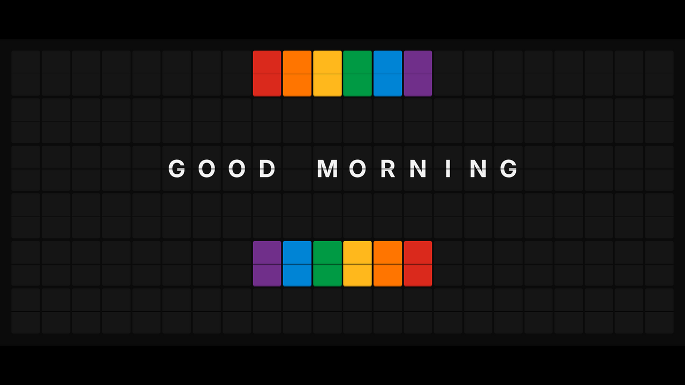

# Wyffpack Fam Bam Board

Our family quote board: a 6×22 Vestaboard-style split-flap display for the TV. It's a fork of [FlipOff](https://github.com/magnum6actual/flipoff) (MIT).



- 6 rows × 22 columns of portrait "bits" that fill a 16:9 screen
- Each tile flips forward through its drum (A→B→C…), like the real mechanism, with a soft click for every flap
- Vestaboard color tiles: `{red} {orange} {yellow} {green} {blue} {violet} {white} {black}`
- Vestaboard character codes, so a 6×22 code grid from the Vestaboard/VBML API displays as-is
- Live `{time}`, `{date}` and `{day}`
- Messages come from `messages.json`, which the page re-checks every minute, so you can change the board from your phone
- No build step and no dependencies. It's plain HTML/CSS/JS.

## Setting it up on a Samsung TV (Tizen, e.g. the U7900F)

1. **Host it.** The easiest way is GitHub Pages. Push this repo to GitHub, then go to **Settings → Pages → Deploy from branch → `main` / root**. You'll get a URL like `https://walleryffels-jdl.github.io/wyffpack-fam-bam-vb/`. That address opens a menu where you pick the **Flip Board** (`board.html`) or the **Arrow Sign** (`sign/`) with the remote. Press Back to return to the menu. The menu remembers your last pick and opens it by itself after 5 seconds when the page is freshly opened; press any button to stay on the menu.
2. **Open it on the TV.** Open the **Internet** app, go to the URL, and bookmark it.
3. **Go full screen.** Use the browser's own full-screen option in its menu, or press **F** on a keyboard.
4. **Turn on sound (optional).** Press **OK/Enter** on the remote once. Browsers only allow sound after you interact with the page.
5. **Keep the screen on.** In the TV settings, turn off the screen saver ("Auto Protection Time") and any eco or auto power-off timers. Menu names vary by model and software version. The page also asks the browser to keep the screen awake. The U7900F is an LCD, so a static board won't burn in.

Remote and keyboard controls:

| Key | Action |
| --- | --- |
| OK / Enter / → | Next message |
| ← | Previous message |
| F | Full screen |
| M | Mute or unmute |

## Changing the messages

Edit `messages.json`. (The grid line in the example below is shortened.) You can do this from the GitHub mobile app or github.com, and the TV picks it up within a minute or two after Pages redeploys.

```json
{
  "duration": 20,
  "messages": [
    "Plain text wraps and centers automatically",
    { "lines": ["{day}", "{date}", "", "{time}"], "duration": 30 },
    { "lines": ["{red}{red} DINNER AT 7 {red}{red}"] },
    { "text": "Left aligned, top of the board", "align": "left", "valign": "top" },
    { "grid": [[0,0,0,...22 codes...], ...6 rows...] }
  ]
}
```

- **duration** is how many seconds a message stays up. Set it per message or for the whole file.
- **volume** sets how loud the flaps are for the whole board: `1` is normal, `0.5` is half, and `0` is silent. Try `1.5` or `2` to make it louder.
- **lines** shows one line per row. A line longer than 22 characters wraps.
- **text** wraps automatically. Use `\n` to force a new line.
- **grid** takes raw Vestaboard character codes (0 is blank, 1–26 are A–Z, 63–70 are colors, and so on).
- `{63}` through `{70}` and the other numeric codes also work inline, the same as in VBML.
- Supported characters are `A–Z 0–9 ! @ # $ ( ) - + & = ; : ' " % , . / ? °`. Anything else shows as a blank tile.

## The sign page

There's a second page at **`/sign/`** (https://walleryffels-jdl.github.io/wyffpack-fam-bam-vb/sign/). It looks like a roadside marquee sign: a black arrow along the top with flashing globe bulbs, a white ribbed panel with black and red slide-in letters. It shows one message and keeps it up until you change it. When you do, the old letters come off and the new ones slide in.

Edit `sign/messages.json`:

```json
{
  "arrow": "right",
  "lights": "blink",
  "theme": "christmas",
  "message": { "lines": ["{candy}MERRY", "{candy}CHRISTMAS", "{black}FROM THE", "{green}WYFF PACK"] }
}
```

- **message** is plain text, which wraps and centers automatically, or `{ "lines": [...] }` for one line per row. The panel holds 4 rows of 20 letters.
- `{red}`, `{green}` and `{black}` switch the color of the letters that follow. `{candy}` alternates red and green letters.
- **arrow** is `right` or `left`.
- **lights** is `blink` (all flash together), `chase` (running toward the tip), `on` or `off`.
- **theme** `"christmas"` makes the bulbs red, white and green (always in that order), snow on the arrow and falling snow. Remove the line (or set it to `"none"`) to go back to the plain sign.

## URL options

These go on the board's address, for example `board.html?volume=0.5`.

| Option | Example | What it does |
| --- | --- | --- |
| `msg` | `?msg=HELLO&msg=WORLD` | Show these messages instead of `messages.json` |
| `feed` | `?feed=https://…/board.json` | Load messages from another JSON file (it must allow CORS) |
| `duration` | `?duration=45` | Seconds per message |
| `sound` | `?sound=0` | Start muted |
| `volume` | `?volume=0.5` | Flap volume (1 is normal) |
| `sound` | `?sound=classic` | Play FlipOff's single recorded clip instead of a click per flap |

## Running locally

```bash
python3 -m http.server 8080
# open http://localhost:8080
```

If you open `board.html` straight from disk, `messages.json` can't load, so the built-in messages in `js/messages.js` are shown instead.

## License

MIT. Based on FlipOff.
